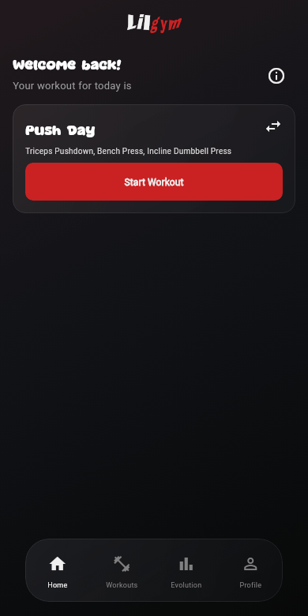
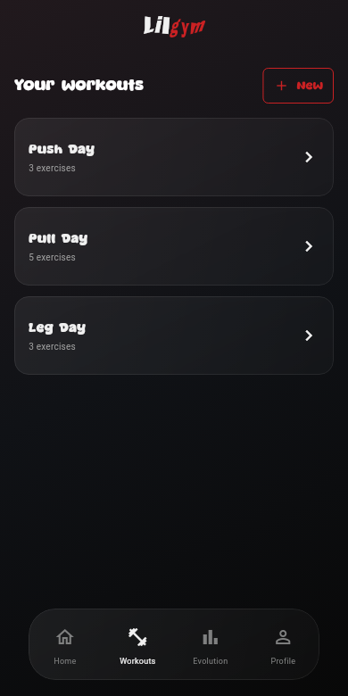
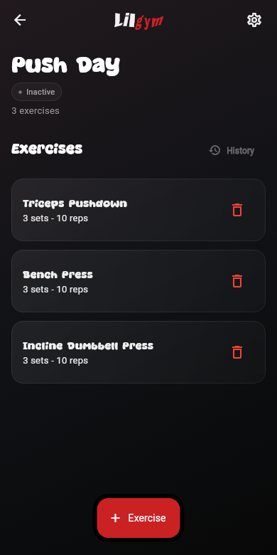
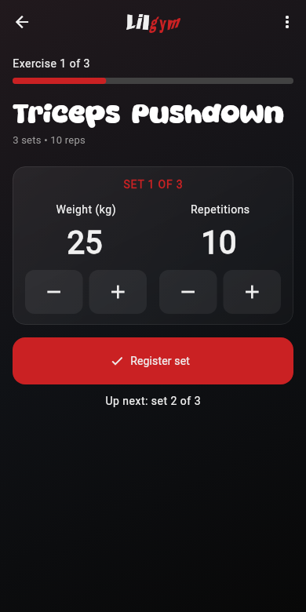

# lilgym

> just a lil more progress, one set at a time

A minimal workout tracker built with Flutter. Pick your workout, log your sets, and pick up where you left off — with a dark, glass-style interface that keeps the next rep in focus.

Sibling project of [lilnote](https://github.com/ericfr1tzenvalle/lilnote) and [lil-code](https://github.com/ericfr1tzenvalle/lil-code). Same philosophy: small apps, focused interfaces.

<p align="center">
  
</p>

## A little less friction

- Build workouts from the exercise catalog.
- Log weight and reps, with previous-session values ready for your next set.
- Pick up an active session after restarting the app.
- Finish your workout and look back at your sessions and sets in History.

<p align="center">
  
  
  
</p>

## Run it

You'll need Flutter, the Android SDK, JDK 17, and an Android device or emulator. In Firebase Authentication, enable **Email/Password** and place the Android configuration in `android/app/google-services.json`. The Firebase Android package must match `com.example.gym_tracker`.

```bash
flutter pub get
flutter devices
flutter run -d <android-device-id>
```

Sign in or create an account online. Workouts and history are stored on the device, separately for each account, and are available offline after sign-in.

### Checks and APK

```bash
flutter analyze
flutter test
flutter build apk --release --target-platform android-arm,android-arm64
```

Download the [LilGym APK](release/lilgym-release.apk) or find your local build at `build/app/outputs/flutter-apk/app-release.apk`. It supports ARM Android phones on Android 7 or later.
